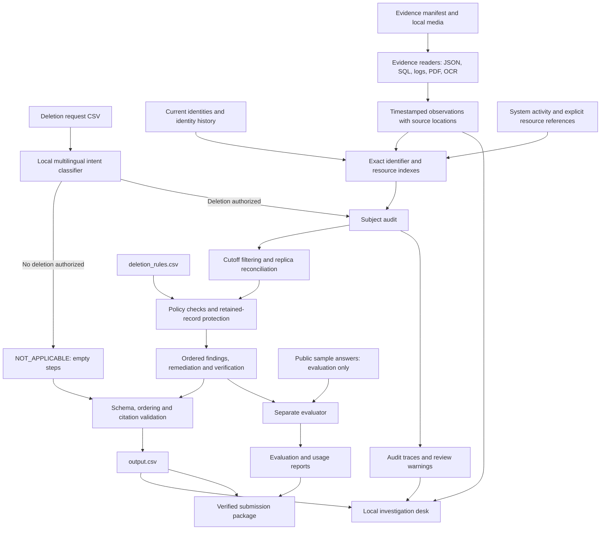

# Ghost Protocol — Northstar Deletion Audit

An offline investigation tool for the **Ghost Data Still Exists** challenge. It checks whether a deletion request was actually completed across the supplied systems, explains what remains, and produces an ordered remediation and verification plan.

A dashboard saying “Complete” is only a claim. This project checks the underlying records, replicas, identifiers and processes before deciding what the evidence supports.

The submitted runtime uses a small local intent classifier, neural OCR and explicit policy logic. It requires **no paid API, API key, hosted LLM, Node installation or frontend build**. Codex helped develop the project; it is not invoked by the submitted application.

## What the project delivers

- One prediction for each of the **518 official requests**, sorted by `case_id`.
- The exact CSV schema: `case_id,deletion_status,steps_json`.
- Current and historical identity resolution using emails, phones, hashes and stable subject references.
- Readers for CSV context and all **94 supplied evidence files**: JSON, SQL snapshots, logs, text, PDFs and PNG screenshots.
- Detection of remaining personal data, surviving replicas, active synchronization and unsafe restore paths.
- Policy-aware deletion, redaction and anonymization plans that preserve required retained records and permitted tombstone references.
- A local investigation desk with source inspection and review warnings.
- An evaluation workflow, readable results, inference-usage accounting and validated submission packaging.

This is an audit and planning tool. It does not connect to production systems or execute the proposed deletion actions.

## Architecture



The main path is: **request → identity links → observed state at the cutoff → policy → ordered answer**. Sample labels feed only the separate evaluator. They are never used to resolve a person, select a resource or generate a prediction.

## Setup

Python **3.12** was used for testing. Run these commands from the repository root:

```powershell
git clone https://github.com/pjha26/Deletion_audit.git
cd Deletion_audit
python -m venv .venv
.venv\Scripts\python -m pip install -r code/requirements.txt
.venv\Scripts\python code/main.py
.venv\Scripts\python code/ui.py
```

Open **http://127.0.0.1:8765**. To use another port:

```powershell
.venv\Scripts\python code/ui.py --port 8766
```

On macOS/Linux, replace `.venv\Scripts\python` with `.venv/bin/python`. Once the environment is activated, the shorter `python` commands below work on either platform.

Dependencies are `pypdf` and `rapidocr-onnxruntime`, with their installed dependencies. The first installation needs internet access. OCR model files are supplied through the installed RapidOCR package; inference runs locally afterward. A compatible ONNX Runtime wheel is required for the target platform.

### Running from the submitted ZIP

Extract `code.zip` so that `code/` is directly inside the project folder. Place the official participant `dataset/` beside it. The archive intentionally excludes the corpus and installed dependencies.

For audit generation and the UI, use the same setup commands after creating the virtual environment. To rerun the **packaging** workflow, also place the separately submitted `log.txt` at the project root; packaging requires the transcript. Public sample evaluation requires the official sample CSVs in `dataset/`.

## Input files

| Input | Purpose |
|---|---|
| `dataset/deletion_requests.csv` | Requests to audit and their historical cutoffs |
| `dataset/user_identities.csv` | Current identity values |
| `dataset/user_audit_log.csv` | Historical identity changes |
| `dataset/system_activity.csv` | Service activities and process relationships |
| `dataset/deletion_rules.csv` | Required treatment for each data category |
| `dataset/evidence_files.csv` | Evidence IDs, paths, origins and capture times |
| `dataset/evidence/` | Original logs, snapshots, business documents and screenshots |
| `dataset/sample_deletion_requests.csv`, `dataset/sample_output.csv` | Public evaluation only |

Paths default to the project root regardless of the shell's current directory. Use explicit flags to audit another compatible participant dataset:

```text
python code/main.py --dataset dataset --requests dataset/deletion_requests.csv --output output.csv
```

## How an audit is decided

**Authorization comes first.** A locally trained character-ngram Naive Bayes model distinguishes deletion from access, correction, export and other requests. Explicit prohibitions help prevent “do not delete” from being treated as authorization. The training examples are visible in `code/intent.py`; model scores are not calibrated probabilities.

**Identity is reconstructed across time.** Exact identifiers and historical changes connect records to the requested person. Names alone do not merge people. Explicit source/parent resource references can be followed in both directions and over multiple hops. Conflicting ownership is exposed for review.

**Evidence establishes state.** Readers preserve resource IDs, systems, timestamps, source IDs and locations. Trace IDs join split log events. SQL exports are inspected in an isolated in-memory SQLite connection with restricted execution. PDF text extraction and local OCR make the media searchable. An unsuccessful HTTP read is unknown state, not evidence that a record is absent.

**The cutoff matters.** Later observations cannot establish an earlier state. For exported log/JSON bundles, the implementation treats an explicit embedded event/readback timestamp as the original observation time and the manifest timestamp as the export/container time. PDFs and screenshots use their manifest capture time. This interpretation, and the alternative stricter availability interpretation, are documented in the evaluation report.

**Copies and retention are checked separately.** Primary absence does not clear a surviving independent replica. A retained security or legal record must remain available. Shared support records are evaluated for the requested subject's identifiers, preserving permitted information about other people. Tombstones preserve permitted stable references while prohibited direct identifiers are removed.

**The planner orders the work.** Active flows are disabled and unsafe restores blocked before record changes. Findings cite current evidence. Proposed actions and future checks do not pretend to have completed evidence. The final sequence follows the challenge's phase, operation, system and resource ordering.

## Output contract

`output.csv` contains exactly these columns:

```csv
case_id,deletion_status,steps_json
```

| Status | Meaning in this implementation |
|---|---|
| `NOT_APPLICABLE` | The request does not authorize deletion; `steps_json` is `[]` |
| `INCOMPLETE` | Supported violations or recreation risks remain; steps contain findings, remediation and final checks |
| `COMPLETE` | Discovered relevant resources satisfy the supplied policy; steps contain evidence-backed verification |

Every step has exactly `step_no`, `phase`, `system_id`, `resource_id`, `operation`, `state` and `evidence_id`. Numbering starts at 1. Findings precede remediation, followed by verification. Findings and COMPLETE verification cite participant-visible sources; future work uses an empty evidence ID.

Before export, validation checks case coverage, ordering, statuses, fields, operation/state pairs, duplicate steps and citation membership in the selected case's resource trace. Empty COMPLETE proof is rejected. Unknown states and missing required retained records cause an explicit error rather than an invented compliant result.

`COMPLETE` is bounded by discovered evidence. It is not a certificate covering records whose lineage was lost or systems outside the supplied corpus. Review warnings remain visible even when the required challenge CSV uses that status.

## Investigation desk

The UI runs on a standard-library Python HTTP server bound to loopback. Its HTML, CSS, JavaScript and icons are local assets.

- Searchable case queue with verdict and review filters.
- Subject-to-resource trace map and current/historical identity trail.
- Timeline showing included observations and those excluded by the cutoff.
- Ordered remediation ledger with clickable citations.
- Original log, SQL and text views, plus image and PDF previews.
- Measured evaluation, local model usage and failure analysis.
- A real **Run audit** action and CSV export.

The visual design follows an investigation dossier rather than a generic analytics dashboard. On small screens, resource navigation stays readable instead of shrinking the desktop graph.

A COMPLETE prediction with unresolved evidence limitations displays a **REVIEW** stamp and its underlying CSV verdict. Input, engine, CSV and trace fingerprints detect stale results; export is blocked until a fresh audit when those fingerprints differ. The local service accepts only fixed actions and allowlisted evidence IDs, with Host/Origin checks on requests.

## Tests, evaluation and packaging

For a complete submission refresh:

```text
python code/finalize.py
```

This runs the authored tests, public evaluation, all official requests, failure analysis, report generation and packaging. It stops if a command fails. Detailed command output goes to `work/finalize.log`. By default the submission files are written to `../outputs/`; use `--destination` to choose another folder.

Individual commands:

```text
python code/evaluation/checks.py
python code/evaluation/main.py --run-samples
python code/main.py
python code/evaluation/failure_audit.py
python code/evaluation/report.py
python code/package_submission.py --destination ../outputs
```

The full audit must follow sample evaluation before generating final usage reports. `finalize.py` enforces that sequence. Reports and packages must match the recorded full-run fingerprints. CSV and JSON exports use atomic file replacement; source or engine changes during processing preserve the previous CSV rather than publishing a mixed run.

Optional browser QA is in `code/tests/browser_check.js`. It requires a separately installed Playwright and browser, plus a running local UI. Configure `PLAYWRIGHT_MODULE`, `BROWSER_EXECUTABLE` and `AUDIT_URL` when needed. These are development tools, not application dependencies.

### Measured results

The checked-in report records **43 passing authored tests**, all 94 evidence files read, and 518 output rows. Browser checks covered real inference, source viewers, CSV export and desktop/tablet/mobile layouts with no recorded JavaScript errors. A separately extracted ZIP reproduced the exact CSV; a cold OCR run processed all 11 images and produced the same predictions.

| Public development-sample metric | Result |
|---|---:|
| Cases evaluated | 32 |
| Deletion-status accuracy | 31/32 — 96.88% |
| Exact full-case agreement | 15/32 — 46.88% |
| Step precision, phase/operation/system/resource | 97.16% |
| Step recall using the same key | 88.60% |
| Strict step accuracy, all seven fields | 65.80% |
| Field accuracy | 85.34% |

These samples were used during development. They are not an independent estimate of hidden-set accuracy. One public sample remains unresolved and is counted as wrong. The detailed differences and source-backed diagnosis are in `code/evaluation/evaluation_report.md` and `code/evaluation/failure_audit.md`.

Inference uses **zero LLM calls and USD 0 paid API cost**. Local classifier/OCR calls, cache hits and measured elapsed time are reported separately in `code/evaluation/usage_report.md`. This does not claim that hardware, electricity or installation bandwidth have no cost.

## Files and responsibilities

```text
Deletion_audit/
├── README.md                    Project guide and architecture
├── decisions.md                 Design choices and trade-offs
├── code/
│   ├── main.py                  Audit CLI, validation and exports
│   ├── evidence.py              Evidence extraction and provenance
│   ├── intent.py                Local intent model and authored examples
│   ├── audit.py                 Identity, reconciliation, policy and planning
│   ├── ui.py                    Local server and fixed UI actions
│   ├── ui/                      HTML, CSS, JavaScript and icon
│   ├── tests/                   Authored regression and browser checks
│   ├── evaluation/              Evaluator, analysis and measured reports
│   ├── finalize.py              End-to-end verification and packaging
│   ├── package_submission.py    Validated code archive and submission copies
│   ├── README.md                Archive-ready copy of this guide
│   ├── decisions.md             Archive-ready decision record
│   ├── INTERVIEW_GUIDE.md        Questions grounded in the implementation
│   └── requirements.txt         Runtime dependencies
├── dataset/                     Official participant corpus; excluded from ZIP
├── output.csv                   Generated submission predictions
├── log.txt                      Append-only development transcript
└── work/                        Local caches, traces and checks; excluded from ZIP
```

After a run, `work/audit_traces.json` contains case-level identity links, observations and review reasons. `work/cache/coverage.json` records evidence coverage; `work/cache/last_usage.json` records inference counts and fingerprints. They contain fictional corpus data and are not shipped in the code archive.

## Known limits and next improvements

Exact answers remain weaker than status classification. Already-deleted or anonymized records can lose the identifier needed to connect them back to a person. The implementation does not copy resource IDs from expected answers or infer ownership from numeric naming patterns to fill that gap.

A unique primary workflow event within ten minutes of the reported time can be treated as a weak candidate when explicit linkage is unavailable. Its reported success never proves deletion, a different explicit owner blocks the link, and the uncertainty is disclosed in the trace.

OCR can misread identifiers. The small multilingual classifier needs broader independent language and negation tests before operational use. Conflicting catalog/display identities, expired retention conditions without a fallback policy, and missing retained records require review. The challenge vocabulary has no restore-record action for repairing missing required retained data.

Use `python code/main.py --strict-review` to refuse export when review warnings remain. This intentionally blocks the current corpus's uncertain cases; default challenge mode still writes all required rows using the official three-status schema.

The most useful next improvements are durable subject-to-resource lineage, independently labeled intent tests, identifier-level OCR evaluation and clarification of the export-time interpretation. They need evidence and validation rather than last-minute label-specific patches. `decisions.md` explains these choices in more detail.

## Submission

Upload **code.zip**, **output.csv** and **log.txt** to the challenge:

https://www.hackerrank.com/contests/hackerrank-orchestrate-october26/challenges/ghost-data-still-exists

The ZIP excludes `dataset/`, caches, virtual environments, dependencies and nested archives. Evaluation and usage reports are included. `submission_manifest.md` records checksums of the three upload files. The official contract remains in `problem_statement.md`; the development logging requirements remain in `AGENTS.md`.
