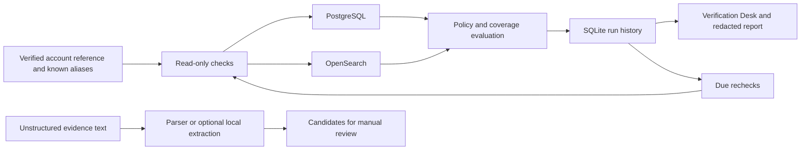

# Ghost Protocol V2 — Verification Desk

Verify the result of an existing deletion workflow across configured systems. The local demo uses PostgreSQL and OpenSearch with fictional records. It exercises a primary profile, a downstream search document, a required retained audit record and a per-account sync guard.



## Run locally

Use Python 3.12 and Docker Compose. Run commands from the repository root. The original HackerRank project has its own entry point in `code/`.

```powershell
python -m pip install -r verification/requirements.txt
python -m verification.demo_env
docker compose --env-file work/ghost-demo.env -f verification/compose.yaml up -d
Get-Content work/ghost-demo.env | ForEach-Object {
  $key, $value = $_ -split '=', 2
  [Environment]::SetEnvironmentVariable($key, $value, 'Process')
}
python -m verification.demo seed
python -m verification.demo permissions
python -m verification.demo delete-primary
python -m verification.app serve
```

Open [the local Verification Desk](http://127.0.0.1:8772). In Bash, load the generated file before invoking Python with `while IFS='=' read -r key value; do export "$key=$value"; done < work/ghost-demo.env`. Load the environment in a second terminal to run the synthetic fixture actions while the app serves. `demo_env` reuses existing credentials so container restarts keep working.

1. Select **GP-1042** and choose **Run verification**. The primary profile is absent, the search copy remains, and the retained audit record is present. The sync guard is active. The case is incomplete.
2. For an ownership conflict, select **GP-1057** and run verification while the stale copy exists. Its alias points to another known subject, so the search check requires review.
3. Run `python -m verification.demo clean-copy` in the second terminal. Return to GP-1042 and run verification. All four checks should pass. Open the search check to inspect the timestamp, expected state and evidence reference.
4. Run `python -m verification.demo replay-sync`. The demo case rechecks every 15 seconds after its first run. The next successful check detects the reappearance and links back to the earlier run that found the copy absent. The incident remains visible until a conclusive check finds that copy absent again.
5. Use **Download report** to export the selected run. The report includes the case reference, policy, scope, checks and follow-up while omitting aliases and the stable subject reference. Use opaque case references.

The fixture operator writes to the isolated demo services with separate credentials. The web app and scheduled worker only collect observations and store results. The permission probe confirms the reader can query its approved targets and cannot update PostgreSQL or write to the search index.

To run an audit from the terminal, use `python -m verification.app run GP-1042`. Operators can add a verified case with `python -m verification.app add-case CASE-ID ACCOUNT-REF --alias old@example.test --every 15`. Registration assumes the account reference and aliases have been verified by the existing request workflow. `--every 0` disables recurring checks. History and due times persist in `work/ghost-v2.sqlite3`. To stop the demo services while retaining their data, use `docker compose --env-file work/ghost-demo.env -f verification/compose.yaml stop`.

## Coverage and evidence

- **Verified in scope** means all four configured checks passed for the recorded observation times. The tool checks only the supplied reference and aliases, the supported tables and index, and the modeled sync guard.
- **Incomplete** means at least one check proved a policy violation. Any unresolved checks remain visible.
- **Needs review** means the verifier could not establish all required states. A conflicting subject, missing guard, unavailable source, incomplete search, or unsupported index mapping prevents verification.

The two stores are read independently. The audit records individual observation times and reflects what was visible during the run. Historical links label a return as a new observation. They do not infer which job caused the return. The local model has no connector access, so its suggestions cannot set a verdict or change a record.

The demo supports a fixed fixture schema and local single-operator use. Compose binds the services to loopback, and the OpenSearch demo certificate exception is restricted to loopback. A staging pilot would need approved credentials with the same least-privilege grants, trusted TLS, authentication and evidence retention controls. There is no commercial pilot or production validation yet.

## Evaluation

```text
python -m unittest verification.test_verification -v
python -m verification.evaluate
python -m verification.evaluate --model-url http://127.0.0.1:18087
```

The verification suite covers 81 combinations of policy and evidence states, partial queries, wrong ownership, missing checks, recurrence across a worker restart, duplicate schedules and redaction. Live browser checks exercise cases and filters, evidence, historical links, real scheduled detection, file export, and responsive layout.

The separate extraction benchmark freezes ten synthetic documents with seven expected facts. The parser matched **3 of 7**. Adding **Qwen2.5-0.5B-Instruct Q4_K_M** on llama.cpp **b12521** also matched **3 of 7** and produced four incorrect candidates. A citation validator checks the exact quote and subject reference, but those checks cannot establish that the cited text actually supports the model's interpretation. Keep model extraction optional and review every model suggestion.

To reproduce the optional experiment, run a local [llama.cpp server](https://github.com/ggml-org/llama.cpp) with the [official Qwen GGUF weights](https://huggingface.co/Qwen/Qwen2.5-0.5B-Instruct-GGUF) on `127.0.0.1:18087` and pass its origin to the evaluator. The extractor also accepts text exported from the existing PDF/OCR pipeline with `python -m verification.extract note.txt ACCOUNT-REF --model-url http://127.0.0.1:18087`. Keep raw notes and model weights outside source control. Parsed and suggested evidence stays outside the automated verdict.
